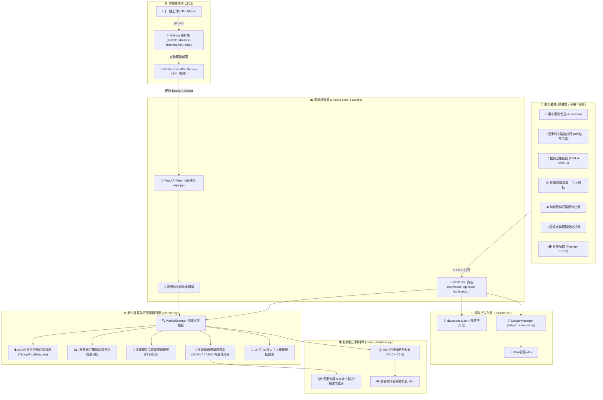

# 🏛️ 阿爾比恩黑市雷達 - 系統架構圖譜與模組全景 (Architecture Graph)

> **最後更新時間**：2026-10-28  
> **系統狀態**：全面升級雲端免開機託管（Render.com）、皇家大陸 6 大城市製造加成分頁、猛獁 360M 目標任務樹、專精持久化。

---

## 🌐 系統整體架構圖 (Mermaid Flowchart)

---

## 🧩 核心功能模組社群 (Community Modules)

### 1. 前端交互層 (Frontend Layer)
- **檔案**：`static/index.html` (Single Page Application, Vue 3 + Tailwind CSS CDN)。
- **核心分頁**：
  - **黑市套利雷達**：紅城原料 vs 黑市買單利潤排行、專注效率、安全批次量、流動性標籤。
  - **皇家城市製造**：依據白城、綠城、黃城、藍城、紫城之「精煉與製造加成」計算原產地成本，對比黑市利潤與日誌產出。
  - **猛獁之路任務系統**：360M 目標進度條、階段 I~IV 一鍵智慧選品、今日日常作戰 SOP 清單。
  - **批量採購清單**：多品項匯出採購文字、紅城島 15 位 T6 獵人工人產能無縫折抵。
  - **跨城原料行情**：6 大城市 4.0~6.3 皮布木鐵即時單價看板。
  - **記帳本**：快速一鍵收錄單品利潤、刪除表記、導出 Excel。
  - **專精配置**：內圈母節點 (0~100)、單品外圈 (0~100) 即時輸入並自動同步至雲端檔案。

### 2. 服務與 API 路由層 (API & Web Service Layer)
- **檔案**：`app.py` (FastAPI + Uvicorn)。
- **主要端點**：
  - `GET /`：渲染前端單頁應用。
  - `GET /api/status`：讀取市場掃描器狀態與上次掃描時間。
  - `POST /api/scan`：手動觸發 AODP 實時行情重新抓取。
  - `GET /api/radar`：返回 960 件裝備之套利排行、各城原料價格、品質分佈。
  - `GET /api/specs` & `POST /api/specs`：讀寫使用者專精資料（支援 Debounce 自動防手震存檔）。
  - `GET /api/ledger` & `POST /api/ledger`：記帳本記錄管理與統計。
  - `GET /api/export-excel`：導出最新記帳 Excel 檔案。

### 3. 量化計算與掃描引擎層 (Engine Layer)
- **檔案**：`scanner.py`。
- **計算模組**：
  - **多城材料行情掃描 (`fetch_materials`)**：同時併發抓取 Caerleon, Fort Sterling, Lymhurst, Bridgewatch, Martlock, Thetford 六大城市之精煉材料賣單最低價。
  - **黑市實時行情 (`fetch_black_market_prices`)**：抓取黑市最高收購價。
  - **黑市深度與銷量 (`fetch_black_market_history`)**：抓取 AODP 歷史成交數據，計算日均消化速度與 7 天成交均價。
  - **向下相容期望價公式 (`calculate_safe_batch`)**：依據玩家真實專精計算品質骰機率，以黑市高階吃低階規則計算期望淨利。
  - **皇家城市利潤演算**：套用專屬製造返還率（無專注 24.8% / 下專注 47.9%），精準推算各城實質成本。

### 4. 裝備配方資料庫層 (Database Layer)
- **檔案**：`items_database.py`。
- **涵蓋內容**：
  - 960 件裝備（獵人小屋、法師之塔、戰士鐵匠鋪、工匠配件）之材料消耗與階級映射。
  - 皇家大陸 6 大城市製造加成矩陣（例如：綠城獵人加成、藍城斧/十字弓加成、黃城法杖加成等）。
  - 工人日誌產出與專注點消耗公式。

### 5. 雲端部署與維運層 (DevOps Layer)
- **平台**：Render.com (Free Tier) + GitHub。
- **配置檔案**：`render.yaml`、`Dockerfile`、`Procfile`、`requirements.txt`、`[一鍵上傳GITHUB].bat`。
- **特性**：24 小時免開電腦運行、自動 HTTPS 憑證、GitHub push 自動觸發部署。

---

## 📦 專案檔案清查與廢棄狀態診斷 (File Audit)

| 檔案 / 資料夾 | 大小 | 狀態 | 診斷與建議處置 |
| :--- | :--- | :--- | :--- |
| `app.py` | ~21 KB | **生產中** | FastAPI 核心主程式，支援本地與雲端自動 PORT 適配。 |
| `scanner.py` | ~42 KB | **生產中** | 多線程市場掃描與量化計算引擎。 |
| `items_database.py` | ~31 KB | **生產中** | 960 件裝備配方庫與皇家城市加成矩陣。 |
| `ledger_manager.py` | ~7 KB | **生產中** | 記帳管理模組。 |
| `static/index.html` | ~250 KB | **生產中** | 前端 Web 儀表板，已修復排版與階級篩選。 |
| `data/specs.json` | ~0.2 KB | **生產中** | 專精配置永久保存檔案。 |
| `data/記帳.xlsx` | ~5 KB | **生產中** | 記帳試算表。 |
| `data/武器材料名稱對照表.xlsx` | ~10 KB | **生產中** | 裝備名稱與材料對照表。 |
| `[一鍵上傳GITHUB].bat` | ~2 KB | **生產中** | 方便一鍵將最新修改推送至 GitHub 觸發雲端自動更新。 |
| `啟動黑市雷達.bat` | ~0.4 KB | **本機備用** | 當需要本機電腦離線執行時的啟動器。 |
| `render.yaml` / `Dockerfile` / `Procfile` | ~1 KB | **生產中** | 雲端主機配置規範檔。 |
| ❌ `static/index.html.reconstructed` | 519 KB | **已刪除廢棄** | 先前修復過程之暫存還原檔，完全未被引用，已清理。 |
| ⚠️ `cloudflared.exe` | 55.3 MB | **冗餘廢棄** | 舊方案之 Cloudflare Tunnel 執行檔。目前專案已轉移至 Render 雲端託管，此檔不再使用，可安全刪除釋放空間。 |
| ⚠️ `[外網遠端連線]啟動雲端通道.bat` | ~1.5 KB | **冗餘廢棄** | 呼叫 `cloudflared.exe` 的腳本。目前已有 Render 永久網址，此腳本已無作用。 |
| ⚠️ `archive/` | 145 MB | **歷史封存** | 2026/10/22 舊版 PyQt5 桌面版與 PyInstaller 打包產物。已自 Git 排除，不影響雲端。可視需要移至備份區。 |
| ⚠️ `debug_data/` | ~13 KB | **歷史除錯樣本** | 初期開發時之 JSON 測試樣本。 |
| ℹ️ `Albion Data Client/` | 36 MB | **本機選用工具** | 遊戲封包監聽程式。在電腦玩遊戲時開啟可即時推播最新價格至 AODP。已自 Git 排除。 |
